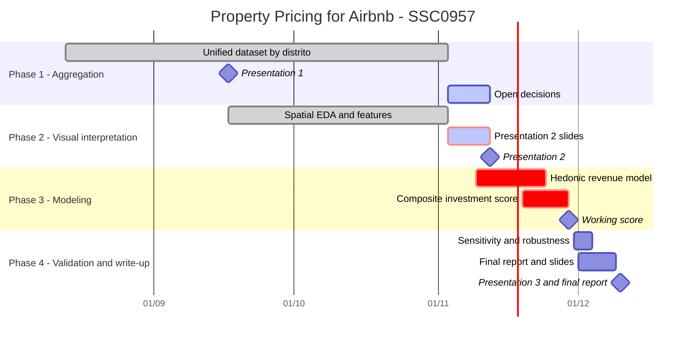

# Timeline and milestones

4-month plan for **SSC0957 — Practical Data Science II**. This is the citable version for the report;
`obsidian-vault/04 - Timeline & Milestones.md` mirrors it for team discussion. Update both when dates shift.
Last update: 2026-11-06.

## Overview

Presentation dates come from the course; Presentation 3 is the currently expected date. Phase 3 and 4 task dates are proposed.

## Phase 1 — Aggregation (month 1) — done, with open decisions

- Collect, geocode and integrate the sources: Inside Airbnb, IPTU-SP, SSP-SP, GeoSampa, IBGE, POIs.
- Clean and diagnose data quality.
- **Milestone:** unified, geolocated dataset at distrito level (Presentation 1, 2026-09-17).
- **Status:** `listings_aggregated.csv` (42,354 × 192) and `distrito_features.csv` (96 × 113) are built by
  `notebooks/aggregation.ipynb`. The DP → distrito crosswalk was reviewed (22 of 94 draft rows corrected),
  crime per 100k residents is computed, and the sensitivity of the crime ranking to the open choices is
  measured (`docs/crime-crosswalk-review.md`, `docs/crime-sensitivity.md`).
- **Still open:** crime basket and denominator (team decision), FipeZAP deflation base, Google Places instead
  of OSM, imputation rule for the 20 distritos with no DP, go/no-go on building `src/`
  (`docs/notes/aggregation-open-items.md`).

## Phase 2 — Visual interpretation (month 2) — technical work done

- Maps and charts (PySAL, seaborn) arguing representativeness; exploratory spatial analysis.
- **Milestone:** exploratory report / checkpoint presentation (Presentation 2, 2026-11-12).
- **Status:** spatial EDA on the distrito polygons (`notebooks/eda_espacial.ipynb`, `docs/eda-espacial.md`):
  global Moran, LISA with FDR, Getis-Ord G*, bivariate Moran, listing-level Moran, `spreg` diagnostics.
  General EDA in `notebooks/eda_agregado.ipynb`. Photo and review feature extraction:
  `notebooks/image_*.ipynb`, `text_processing.ipynb`.
- **Not done:** the checkpoint deck itself (outlines are in the docs above).

## Phase 3 — Modeling (month 3) — not started

- Hedonic revenue model (scikit-learn).
- Spatial analysis: Moran's I / LISA (PySAL), already explored in Phase 2.
- Composite investment score.
- **Milestone:** working investment score per region + property profile (target 2026-11-29).
- Inputs from Phase 2: location carries price information beyond the product (listing-level Moran of the
  profile residual ≈ 0.31); the distrito explains only ≈ 4% of the variance of listing revenue, so
  listing-level and neighbourhood features are worth modeling.

## Phase 4 — Validation and write-up (month 4) — not started

- Sensitivity analysis and robustness checks on the score.
- Final report and presentation.
- **Milestone:** final report submitted and Presentation 3 (2026-12-10).
