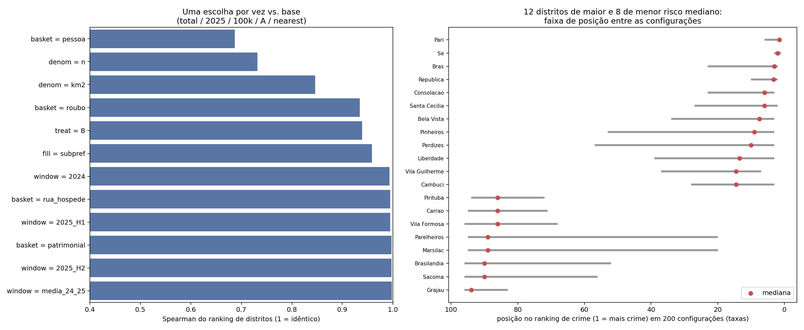

# Risco de crime por distrito: quanto o ranking depende das escolhas em aberto

**Data:** 2026-11-03 · **Branch:** `feature/crime-rate-analysis` · **Material para os slides**
Complementa `docs/crime-crosswalk-review.md` (que cuidou de *a qual distrito* cada DP pertence). Este documento trata de *como medir* o risco.

---

## 1. Pergunta

O vault deixa abertas duas decisões sobre o crime (`obsidian-vault/02 - Data Sources/ISP.md`): **qual cesta de crimes** e **qual janela de tempo**. Há outras escolhas implícitas: dividir por habitante ou por área, tratar vários DPs no mesmo distrito pela média ou pela soma, e como preencher os distritos sem DP.

Em vez de escolher no escuro, medimos **quanto o ranking dos 96 distritos muda** com cada escolha. Isso diz onde vale a discussão do time e onde a escolha é indiferente. **Este documento não decide nada**: indica o que importa.

## 2. Método

`scripts/crime_sensitivity.py` calcula o crime de cada distrito em **300 configurações** (5 cestas × 5 janelas × 3 denominadores × 2 tratamentos × 2 regras de preenchimento) e compara os rankings.

| Dimensão | Opções |
|---|---|
| Cesta | `total` (tudo, como no notebook) · `patrimonial` (furto + roubo) · `roubo` · `pessoa` (homicídio, latrocínio, tentativa, estupro, lesão dolosa) · `rua_hospede` (o que um hóspede a pé enfrenta) |
| Janela | 2025 · 2024 · média 2024–25 · 1º semestre 2025 · 2º semestre 2025 |
| Denominador | por 100 mil habitantes (Censo 2022) · por km² · contagem bruta |
| Vários DPs no distrito | **A:** média dos DPs · **B:** soma |
| Distrito sem DP | herda o valor do vizinho mais próximo · média da subprefeitura |

Configuração-base (a do notebook de agregação, mais a população): `total / 2025 / por 100 mil / A / vizinho mais próximo`. Cada escolha é variada **sozinha**, mantendo as outras na base, e medimos a correlação de Spearman do ranking de distritos e quantos dos 10 distritos de maior crime continuam os mesmos. As definições das cestas estão no topo do script.

## 3. Resultados

| Escolha (uma por vez) | Spearman vs base | Top-10 em comum |
|---|---|---|
| Cesta = `pessoa` | **0,69** | 6 de 10 |
| Denominador = contagem bruta | 0,73 | 7 de 10 |
| Denominador = por km² | 0,85 | 7 de 10 |
| Cesta = `roubo` | 0,93 | 9 de 10 |
| Tratamento B (soma em vez de média) | 0,94 | 8 de 10 |
| Preenchimento = média da subprefeitura | 0,96 | 8 de 10 |
| Janela = 2024 | 0,99 | 9 de 10 |
| Janela = 1º semestre 2025 | 0,995 | 9 de 10 |
| Cesta = `rua_hospede` | 0,995 | 10 de 10 |
| Cesta = `patrimonial` | 0,997 | 10 de 10 |
| Janela = 2º semestre 2025 | 0,998 | 9 de 10 |
| Janela = média 2024–25 | 0,998 | 10 de 10 |

### O que isso diz

1. **A janela de tempo praticamente não importa** (ρ ≥ 0,99). Os totais mensais de 2024 e 2025 são estáveis (36 a 41 mil ocorrências por mês na cidade toda). Pode-se fechar essa decisão sem mais análise.
2. **A cesta só importa em uma divisão:** crimes contra o **patrimônio** (furto e roubo, que são 87% das ocorrências) versus crimes contra a **pessoa**. Total, patrimonial e `rua_hospede` dão praticamente o mesmo ranking (ρ ≥ 0,995). Já `pessoa` muda bastante (ρ = 0,69). A pergunta real para o time é: *o risco que importa ao hóspede é de patrimônio ou de agressão?*
3. **O denominador é a maior alavanca depois da cesta.** Por 100 mil, por km² e bruto contam histórias diferentes (ρ de 0,73 a 0,85). Ver a limitação da seção 5.
4. **Média vs soma dos DPs (tratamento A vs B):** com o crosswalk revisado, ρ = **0,94**. Na mesma métrica (taxa por 100 mil), o rascunho antigo dava ρ = 0,88. A revisão do crosswalk *reduziu* a dependência da escolha, o que sustenta manter o tratamento A como padrão. (O ρ ≈ 0,79 citado na nota de agregação é do rascunho, com outra métrica, e fica desatualizado.)
5. **Como preencher distritos sem DP tem efeito pequeno** (ρ = 0,96): a regra provisória do vizinho mais próximo é aceitável.

### Distritos robustos e sensíveis

Considerando só as 200 configurações que são taxas (contagem bruta não compara distritos de tamanhos diferentes):

| Classe | Distritos | Critério |
|---|---|---|
| **Risco alto robusto** | 11: Pari, Sé, Brás, República, Consolação, Santa Cecília, Bela Vista, Pinheiros, Perdizes, Liberdade, Cambuci | no quartil mais perigoso em ≥ 90% das configurações |
| **Risco baixo robusto** | 53 (ex.: São Miguel, Campo Belo, Penha, Limão, Guaianases, Itaquera, Grajaú, Sacomã) | no quartil mais perigoso em ≤ 10% |
| **Sensível às escolhas** | 32 (ex.: Santo Amaro, Moema, Itaim Bibi, Morumbi, Vila Andrade, Butantã, Mooca, Lapa) | o resto |

Tabelas completas: `outputs/crime_sensitivity_robustez.csv` (classe, faixa de posição, mediana), `outputs/crime_sensitivity_ranking.csv` (valor e posição por distrito em cada configuração) e `outputs/crime_sensitivity_efeitos.csv`.

## 4. Armadilha encontrada: nunca dividir a contagem imputada pela população do distrito

Para os 20 distritos sem DP, o notebook copia a **contagem** do vizinho. Se alguém calcular `crime_total / populacao_2022` direto nas colunas atuais, um distrito pequeno herda uma contagem grande e vira falsamente "o mais perigoso". Exemplo medido: **Marsilac** (11 mil habitantes) iria para o **5º** lugar do ranking (entre Pari, Sé e Barra Funda no topo), quando a posição correta é a **72ª**.

Por isso `aggregation.ipynb` agora calcula `crime_total_100k`, `crime_violento_100k` e `crime_patrimonial_100k` **só nos distritos com DP** e imputa a **taxa** (não a contagem) nos demais. O mesmo vale para `crime_total_km2` na EDA: a contagem imputada é dividida pela área do próprio distrito.

## 5. Limitações e pontos de atenção

- **O centro é favorecido por qualquer denominador.** Os 11 distritos de "risco alto robusto" são todos centrais, com pouca população residente e muita população flutuante (trabalho, comércio, turismo). Por 100 mil *residentes* e por km² a taxa fica alta quase por construção. Nenhum dos denominadores testados mede exposição real. É uma decisão metodológica aberta, importante para o score final: um hóspede no centro está exposto a mais gente do que o Censo conta.
- **`crime_violento` no notebook inclui todos os roubos** (`roubo - outros`, de veículo, de carga). Roubos são 108 mil das 112,5 mil ocorrências assim classificadas (96%), então a coluna mede sobretudo roubo patrimonial. Para risco à pessoa, a cesta `pessoa` desta análise é a mais fiel. Não alterei a coluna existente para não quebrar quem já a usa.
- **Um ano de dados.** 2024 e 2025 (por mês) permitem testar a estabilidade da janela, mas não tendência de longo prazo.
- **Subnotificação e defasagem** de dados oficiais de crime continuam valendo como ressalva do relatório final.
- A sede do DP ainda é um proxy da área de atuação (ver `docs/crime-crosswalk-review.md`).

## 6. Impacto na EDA que já está na `main`

Reexecutei `notebooks/eda_agregado.ipynb` sobre os CSVs regenerados com o crosswalk revisado (cópia local; o notebook do repositório não foi alterado). As conclusões se mantêm, com deslocamentos pequenos:

| Resultado da EDA | Antes | Depois |
|---|---|---|
| Distritos com crime imputado | 25 (33,2% dos anúncios) | 20 (31,1%) |
| ρ(preço mediano, crime/km²), todos | +0,12 (p = 0,34) | +0,16 (p = 0,22) |
| ρ(crime/km², receita estimada) bruta → controlando distância e POIs | +0,55 → **+0,16** | +0,55 → **+0,09** |
| Variância do índice de preço explicada pela tipologia (η² ajustado) | 0,02 | 0,05 |

A leitura relevante: **o crime tem associação independente ainda menor com a receita do que a EDA reportava** (+0,09 depois de controlar localização). Os textos explicativos do notebook que citam os números antigos ficam levemente desatualizados; vale o Yusuke revisar ao reexecutar.

## 7. O que o time precisa decidir (e o que não precisa)

| Decisão | Recomendação desta análise |
|---|---|
| Janela de tempo | Indiferente (ρ ≥ 0,99). Fechar em 2025 inteiro ou média 2024–25. |
| Cesta de crimes | Escolher entre patrimônio e pessoa. Se houver dúvida, manter **as duas** como variáveis separadas em vez de uma só (carregam informação diferente: ρ = 0,69). |
| Denominador | Discutir exposição (população flutuante). Hoje há três opções com ρ de 0,73 a 0,85 entre si. |
| Tratamento A vs B | Manter A (ρ = 0,94 com B após a revisão). |
| Imputação | Manter vizinho mais próximo por enquanto (ρ = 0,96 com a alternativa). |

## 8. Roteiro sugerido para os slides

1. **Pergunta.** Duas decisões em aberto (cesta e janela) e três escolhas escondidas (denominador, A/B, imputação).
2. **Método.** 300 configurações, comparação de rankings (Spearman e top-10).
3. **Resultado principal.** Gráfico de barras da seção 3: janela não importa, cesta e denominador importam.
4. **Mapa de robustez.** 11 distritos de risco alto robusto, 53 de baixo, 32 sensíveis.
5. **Armadilha.** Marsilac iria para o 5º lugar se dividíssemos a contagem imputada pela população.
6. **Limite honesto.** O centro é favorecido por qualquer denominador (população flutuante).
7. **Impacto na EDA.** Crime vs receita cai de +0,16 para +0,09 controlando localização.

Números prontos: **300** configurações · janela **ρ ≥ 0,99** · cesta pessoa vs total **ρ = 0,69** · A vs B **0,94** (rascunho 0,88) · **11 / 53 / 32** distritos robustos altos / baixos / sensíveis · Marsilac **5º → 72º** · crime×receita **+0,16 → +0,09**.

Reprodução: `python scripts/crime_sensitivity.py` (usa `data/reference/dp_distrito_crosswalk.csv`, `data/external/populacao_distrito_2022.csv` e o CSV de crime em `data/processed/{ISP,SSP}/`).
