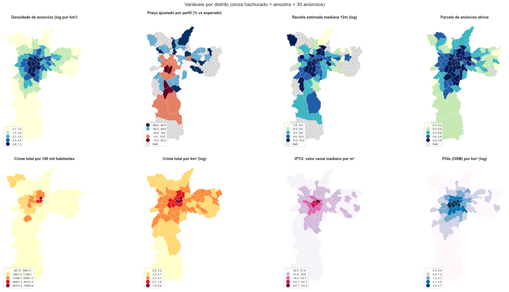
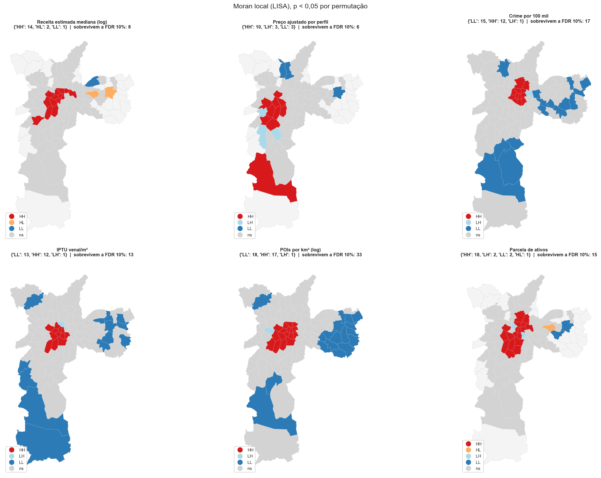
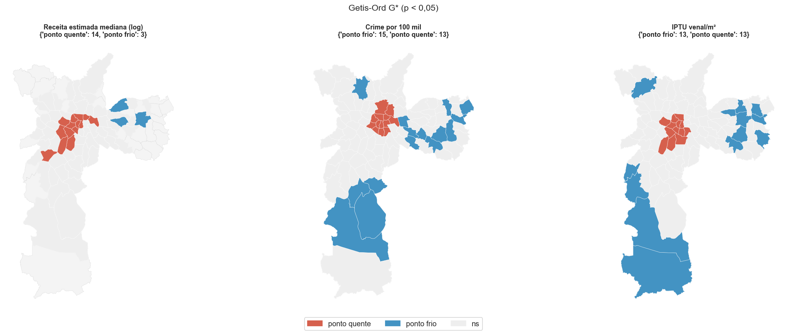
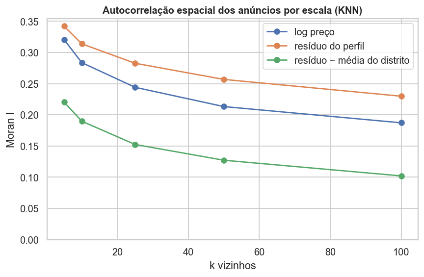

# EDA espacial da base agregada (PySAL)

**Data:** 2026-11-03 · **Notebook:** `notebooks/eda_espacial.ipynb` · **Figuras:** `outputs/eda_espacial/` · **Material para os slides**

Fase 2 do cronograma ("Interpretação visual": mapas e gráficos com PySAL para argumentar a representatividade da base). Complementa `notebooks/eda_agregado.ipynb`, que trata cada distrito como um **ponto** (centroide das coordenadas dos anúncios) e implementa o Moran à mão. Aqui a análise usa os **polígonos reais dos 96 distritos** e a pilha do PySAL: `libpysal` 4.15 (pesos), `esda` 2.10 (Moran, LISA, Getis-Ord, FDR), `splot` 1.1 (mapas e Moran scatterplot), `spreg` 1.9 (regressão com diagnóstico espacial) e `mapclassify` 2.11 (classes dos mapas).

---

## 1. O que foi feito

| Seção do notebook | Técnica (biblioteca) | Pergunta |
|---|---|---|
| 1–2 | Coropléticos, classes Natural Breaks (`mapclassify`) | Como as variáveis se distribuem no mapa? |
| 3 | Pesos Queen e grafo de vizinhança (`libpysal`) | Como definimos "vizinho"? |
| 4 | Moran I global, 9.999 permutações; sensibilidade a Queen, Rook, KNN 5 e 8 (`esda`) | Há autocorrelação espacial? Depende dos pesos? |
| 5 | LISA com correção FDR; Getis-Ord G* (`esda`, `splot`) | Onde estão os aglomerados e os pontos quentes/frios? |
| 6 | Moran I bivariado e LISA bivariado (`esda`) | As variáveis se associam no espaço? |
| 7 | Moran no nível do anúncio, KNN por coordenada | A localização importa além do produto? |
| 8 | η² (variância entre vs dentro dos distritos) | O distrito é uma unidade representativa? |
| 9 | MQO com Moran dos resíduos e testes LM (`spreg`) | Sobra estrutura espacial depois das variáveis exógenas? |

Variáveis: densidade de anúncios, **preço ajustado por perfil**, receita estimada mediana, ocupação estimada, parcela de ativos, crime por 100 mil (e por km²), IPTU venal/m², POIs por km².

**Preço ajustado por perfil:** prêmio de preço do distrito para o *mesmo produto*, a mediana do resíduo de `log(preço) ~ tipo de quarto + capacidade + quartos` (estadias de até 3 noites), em %. Separa "distrito caro" de "distrito com imóveis maiores".

## 2. Cuidados com o dado

- **Amostra mínima:** preço e receita só entram em distritos com ≥ 30 anúncios (71 dos 96). Anhanguera fica sem vizinho nesse subconjunto e é removido (70 distritos). Crime, IPTU e POI cobrem os 96.
- **Crime imputado:** 20 distritos não têm DP e herdam o valor do vizinho (ver `docs/crime-crosswalk-review.md`).
- **Receita e ocupação são estimadas** a partir das avaliações, não observadas (ver `eda_agregado.ipynb`).
- **Testes:** pseudo-significância por permutação (9.999, semente fixa). Nos mapas LISA mostra-se também quantos aglomerados sobrevivem à correção **FDR de 10%**.

## 3. Achados

### 3.1 Tudo é espacialmente agrupado, mas com intensidades diferentes

Moran I global (Queen), todos significativos (p < 0,001):

| Variável | n | I |
|---|---|---|
| Densidade de anúncios (log) | 96 | **0,77** |
| POIs por km² (log) | 96 | 0,75 |
| IPTU venal/m² | 96 | 0,64 |
| Crime por km² (log) | 96 | 0,62 |
| Preço mediano | 70 | 0,49 |
| Parcela de anúncios ativos | 70 | 0,48 |
| Crime por 100 mil | 96 | 0,37 |
| Preço ajustado por perfil | 70 | 0,35 |
| Ocupação estimada | 70 | 0,34 |
| Receita estimada mediana (log) | 70 | **0,30** |

- A conclusão (I > 0 e p < 0,05) **não depende dos pesos**: vale para Queen, Rook, KNN 5 e KNN 8 em todas as variáveis.
- **Estrutura da oferta (densidade, POI, IPTU) é muito mais agrupada que o desempenho (receita, ocupação).** O desempenho de um anúncio depende menos de onde o vizinho está do que a oferta.
- **O denominador muda o mapa do crime:** por km² I = 0,62; por 100 mil habitantes I = 0,37. Por área o crime acompanha a densidade urbana; por habitante o centro se destaca, mas o resto fica menos agrupado.

### 3.2 Aglomerados locais (LISA) e pontos quentes (G*)

| Variável | Distritos em aglomerado (5%) | Sobrevivem a FDR 10% |
|---|---|---|
| Receita estimada mediana | 17 | 8 |
| Preço ajustado por perfil | 16 | 6 |
| Crime por 100 mil | 28 | 17 |
| IPTU venal/m² | 26 | 13 |
| POIs por km² | 36 | 33 |
| Parcela de ativos | 23 | 15 |

- **Receita alta (HH, 14 distritos):** Belém, Moema, República, Pinheiros, Perdizes, Consolação, Jardim Paulista, Itaim Bibi, Bela Vista, Bom Retiro, Vila Andrade, Santa Cecília, Pari e Sé, um arco centro-oeste. O Getis-Ord G* dá os mesmos 14 distritos como ponto quente e três pontos frios na zona leste (Itaquera, Cangaíba, Vila Matilde).
- **Outliers de receita (HL):** Itaquera e Vila Matilde têm receita alta cercados de receita baixa (ilhas de mercado ativo na zona leste).
- **Crime por 100 mil:** 12 distritos centrais em HH (Sé, República, Brás, Bela Vista, Santa Cecília, Pari etc.) e 15 em LL espalhados pelo sul e pela zona leste (Grajaú, Cidade Dutra, Parelheiros, São Mateus, Itaim Paulista etc.).
- **Receita e preço ajustado são os aglomerados mais frágeis:** só 8 e 6 distritos resistem à FDR. Os mapas de receita e preço ajustado são **indicativos**.

### 3.3 O crime é característica de centralidade, não de preço

Moran I bivariado (valor do distrito × valor dos vizinhos):

| X (no distrito) | Y (nos vizinhos) | I | p |
|---|---|---|---|
| POIs por km² | Receita | **0,41** | < 0,001 |
| Crime por km² | Receita | 0,35 | < 0,001 |
| IPTU venal/m² | Receita | 0,31 | < 0,001 |
| Crime por 100 mil | Receita | 0,26 | < 0,001 |
| POIs por km² | Preço ajustado | 0,19 | 0,035 |
| IPTU venal/m² | Preço ajustado | 0,16 | 0,041 |
| **Crime por 100 mil** | **Preço ajustado** | **0,00** | **0,48** |

- Crime se associa **positivamente** com a receita da vizinhança. O motivo é confusão com centralidade: o centro tem mais crime *e* mais receita, porque tem mais turistas e mais demanda.
- **Crime não se associa ao prêmio de preço** (I = 0,002). Hóspede e anfitrião não parecem precificar o crime do distrito, depois de descontar o produto.
- Consistente com a `eda_agregado.ipynb`: a correlação parcial de crime/km² com receita cai de +0,55 para +0,09 ao controlar localização.

### 3.4 Regressão exploratória com diagnóstico espacial

MQO de `log(receita mediana)` em crime por 100 mil, `log(IPTU/m²)` e `log(POIs/km²)`, padronizados (n = 70, R² = 0,39):

| Variável | Coeficiente (desvios-padrão) | p |
|---|---|---|
| POIs por km² (log) | **+0,40** | 0,002 |
| Crime por 100 mil | +0,02 | 0,82 |
| IPTU (log) | −0,02 | 0,86 |

- **Só POI se associa à receita**, e o crime e o IPTU não têm efeito próprio depois dele (colineares: os três medem centralidade).
- **Os resíduos não têm dependência espacial:** Moran dos resíduos p = 0,45; LM lag p = 0,46; LM erro p = 0,73. **Não há evidência para um modelo espacial** (lag ou erro) neste nível e com estas variáveis.
- Cuidado: n = 70, variáveis muito colineares. É exploratório, não um modelo final.

### 3.5 No nível do anúncio, a localização importa além do produto

Moran I dos anúncios (≈ 34 mil, pesos KNN por coordenada), por escala:

| k vizinhos | log preço | resíduo do perfil | resíduo − média do distrito |
|---|---|---|---|
| 5 | 0,32 | 0,34 | 0,22 |
| 10 | 0,28 | 0,31 | 0,19 |
| 25 | 0,24 | 0,28 | 0,15 |
| 50 | 0,21 | 0,26 | 0,13 |
| 100 | 0,19 | 0,23 | 0,10 |

- **Descontar o produto não remove a autocorrelação, e até a aumenta** (0,28 → 0,31 em k = 10). A localização carrega informação de preço que tipo, capacidade e quartos não explicam. Isso sustenta usar variáveis de local no modelo.
- **Parte relevante da estrutura espacial está dentro do distrito:** tirando também a média do distrito, o Moran cai de 0,31 para 0,19 (k = 10), mas **continua positivo**. Cerca de 60% da autocorrelação do resíduo persiste dentro dos distritos.

### 3.6 O distrito é uma unidade grosseira

η² ajustado (parcela da variância *entre anúncios* explicada só por saber o grupo):

| Variável | Por distrito (96) | Por região (5) |
|---|---|---|
| log preço (estadias curtas) | 0,12 | 0,05 |
| resíduo do perfil | 0,15 | 0,08 |
| log receita estimada | **0,04** | 0,01 |

- Saber o distrito explica **12% da variação do preço e só 4% da da receita**. A maior parte da variação está dentro do distrito, entre anúncios.
- Implicação para a modelagem: um score por `distrito × perfil` terá **muita incerteza individual**. O distrito é bom para o contexto (crime, IPTU, POI, que só existem nessa resolução), mas ruim como único preditor de receita.

## 4. Limitações

- **Medianas de distritos pequenos.** Distritos com 30 a 60 anúncios têm preço e receita instáveis. **Parelheiros** aparece como aglomerado de *preço ajustado alto*, mas tem só 61 anúncios com preço, quase todos casas, chalés e cabanas para ~11 pessoas (hospedagem rural/lazer). É um mercado distinto que o perfil (quartos, capacidade) não captura. Tratar como caso à parte.
- **Crime imputado infla um pouco o Moran.** Com só os 76 distritos de crime direto o Moran do crime por 100 mil cai de 0,37 para 0,19 (ainda significativo, p = 0,02). Parte da queda vem de remover distritos centrais: o IPTU, que não tem imputação, também cai (0,64 → 0,51). O crime por km² quase não muda (0,62 → 0,55). Leitura: o agrupamento do crime por habitante é real, porém mais fraco que o 0,37 sugere.
- **Problema da unidade de área modificável (MAUP).** Todos os resultados valem para os distritos. Outra partição pode mudar os números.
- **Receita e ocupação estimadas** a partir de avaliações (ver EDA) e **preços são cotações pontuais**.
- **LISA e G* são exploratórios:** são muitos testes, e só uma parte sobrevive à FDR.
- **Regressão:** n = 70 e colinearidade forte. Não interpretar coeficientes como causais.

## 5. O que isso muda para as próximas etapas

1. **Modelagem:** incluir features de **local** (vizinhos do anúncio, distrito), porque o produto não esgota a variação de preço. Um modelo em nível de anúncio com defasagem espacial local (preço médio dos k vizinhos) tende a capturar o que o distrito perde.
2. **Score de risco:** o crime não explica preço nem receita depois de controlar localização (+0,09 na EDA; coeficiente ≈ 0 aqui). Se ele entrar no score final, é por **decisão de negócio** (risco ao hóspede), não porque prevê receita.
3. **Unidade:** avaliar uma resolução intermediária (hexágonos ou vizinhança KNN) para receita e preço, mantendo o distrito para crime/IPTU/POI.
4. **Modelo espacial:** com as variáveis atuais não há dependência residual no nível do distrito. Reavaliar no nível do anúncio.

## 6. Roteiro sugerido para os slides

1. **Por que espacial.** Pergunta do professor: PySAL. Pilha usada e o que cada peça responde (tabela da seção 1).
2. **Mapas.** Figura `02`: oferta concentrada no centro, crime por 100 mil e por km² contam histórias diferentes.
3. **Autocorrelação global.** Tabela do Moran: oferta (0,6 a 0,8) vs desempenho (0,3). Robusto a pesos.
4. **Aglomerados.** Figuras `05` e `06`: arco centro-oeste de receita; crime no centro; frágeis na FDR.
5. **Crime não é preço.** Moran bivariado: crime × preço ajustado = 0,00; POI é o que se associa. Regressão: só POI.
6. **O anúncio importa mais que o distrito.** η²: distrito explica 4% da receita; Moran do resíduo 0,31 → 0,19 dentro do distrito.
7. **Limitações.** Parelheiros, crime imputado, MAUP.
8. **Próximos passos.** Features de vizinhança, resolução intermediária, modelo no nível do anúncio.

Números prontos: **96** polígonos / **71** com amostra (70 conexos) · Moran **0,77** (densidade) vs **0,30** (receita) · crime **0,62** por km² vs **0,37** por 100 mil · crime × preço ajustado **0,00** · regressão **só POI** (+0,40, p = 0,002) · resíduos sem dependência espacial (p = 0,45) · η² receita **0,04** · Moran do resíduo **0,31 → 0,19** dentro do distrito.

## 7. Reprodução

`notebooks/eda_espacial.ipynb`, de cima para baixo (≈ 4 min, 9.999 permutações). Requer `data/processed/listings_aggregated.csv` com as colunas `crime_*_100k` (gerado por `aggregation.ipynb` depois do PR #6) e `data/external/distrito_municipal.geojson`. Parâmetros no topo: `MIN_N`, `PERMS`, `SEED`, `ALPHA`. O notebook é versionado sem saídas; as figuras são gravadas em `outputs/eda_espacial/`.
