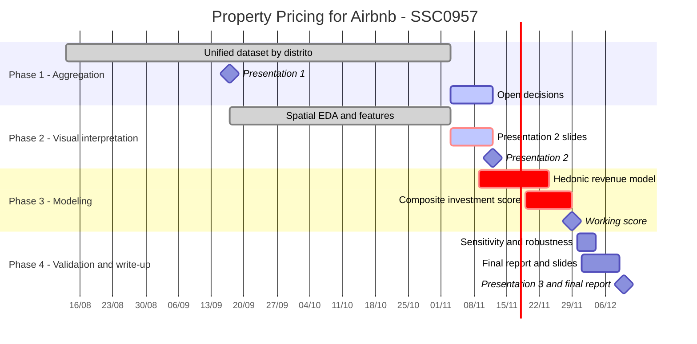

# Timeline & Milestones

4-month plan, mirrored in `../docs/TIMELINE.md`. Update both when dates shift — this note is for team-facing discussion/context, `docs/TIMELINE.md` is the citable version for the report.

## Overview

Presentation dates come from the course; Presentation 3 is the currently expected date. Phase 3 and 4 task dates are proposed.

## Phase 1 — Aggregation (Month 1)

- Confirm current availability/format of each source: [[ITBI]], [[FipeZAP]], [[Inside Airbnb]], [[Google Places - TripAdvisor]], [[ISP]].
- Collect, geocode, and integrate sources.
- Clean and diagnose data quality.
- **Milestone:** unified, geolocated dataset at distrito level (Presentation 1, 2026-09-17).
- Progress (2026-09-07): spatial unit chosen — **distrito** (see [[09 - Spatial Aggregation]]); join routes validated via study on branch `feature/spatial-aggregation`. Remaining: reviewed crime crosswalk, Google Places, population by distrito, then the `src/cleaning/` build. Decision to ratify at next sync.
- Progress (2026-10-28): wide aggregation merged to `main` (PR #3/#4). Next: open items on branch `feature/aggregation-open-items` (see [[09 - Spatial Aggregation]]).

## Phase 2 — Visual interpretation (Month 2)

- Maps and charts (PySal, seaborn) arguing representativeness.
- Exploratory spatial analysis.
- **Milestone:** exploratory report / checkpoint presentation (Presentation 2, 2026-11-12).
- Progress (2026-11-03): spatial EDA with the PySAL stack on the real distrito polygons (`notebooks/eda_espacial.ipynb`, write-up and slide outline in `docs/eda-espacial.md`). Global Moran, LISA + FDR, Getis-Ord G*, bivariate Moran, listing-level Moran, `spreg` diagnostics, η² of distrito. Photo/review feature extraction is done (`notebooks/image_*.ipynb`, `text_processing.ipynb`). Still open: the checkpoint slides.

## Phase 3 — Modeling (Month 3)

- Hedonic revenue model (scikit-learn).
- Spatial analysis: Moran's I / LISA (PySal).
- Composite investment score.
- **Milestone:** working investment score per region + property profile (target 2026-11-29).

## Phase 4 — Validation & writeup (Month 4)

- Sensitivity analysis / robustness checks on the score.
- Final report + presentation.
- **Milestone:** final report submitted and Presentation 3 (2026-12-10).

## Tracking

- #decision and #open-question tags across this vault mark things that affect the timeline — search for them before each weekly sync.
- Meeting-by-meeting progress: `06 - Meetings/`.
